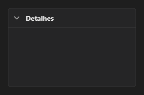

# Expander



Seção que abre e fecha: clique no cabeçalho (ou Espaço/Enter). Fechada, fica só com o cabeçalho; `on_change` traz `expanded`.

**Paleta:** Layouts · **controle visual** · também tem as [propriedades e eventos comuns a todo controle](controles.md)

## Propriedades

### Aparência

| Propriedade | No Object Inspector | Tipo |
|---|---|---|
| `caption` | Título | texto |

### Comportamento

| Propriedade | No Object Inspector | Tipo |
|---|---|---|
| `expanded` | Aberto | lógico |

## Eventos

| Evento | Quando | No Object Inspector | Pergunta |
|---|---|---|---|
| `on_change` | o valor mudou (pelo usuário ou pelo código, como na VCL) | — |  |

## Em código

No form, o `Expander1` com o evento ligado (no Object Inspector, na aba Eventos):

```json
{ "class": "Expander", "name": "Expander1", "on_change": "expander1_change" }
```

E o handler, um método do form (`self.Expander1` já é um `Expander`):

```rust
impl FrmPrincipal {
    pub fn expander1_change(&mut self, ui: &mut Ui, _sender: ComponentId, _args: &EventArgs) {
        let atual = self.Expander1.caption(ui);
        self.Expander1.set_caption(ui, format!("{atual}!"));
    }
}
```
