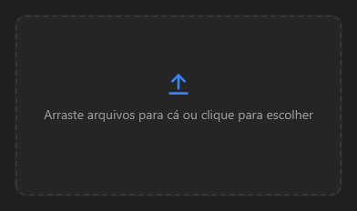

# FileDropZone



Área para soltar arquivos (ou clicar e escolher): borda tracejada, ícone de envio e a lista do que foi escolhido, cada um com "×".

**Paleta:** Additional · **controle visual** · também tem as [propriedades e eventos comuns a todo controle](controles.md)

## Propriedades

### Aparência

| Propriedade | No Object Inspector | Tipo | O que faz |
|---|---|---|---|
| `title` | Título | texto | O texto no meio da área, ao lado do ícone de envio. |

### Comportamento

| Propriedade | No Object Inspector | Tipo | O que faz |
|---|---|---|---|
| `filter` | Filtro | texto | Os tipos aceitos, como no `OpenDialog` (`Imagens\|*.png;*.jpg\|Todos\|*.*`); vazio: todos. |
| `multiple` | Vários | lógico | Aceita vários arquivos (senão, o novo troca o anterior). |

### Dados

| Propriedade | No Object Inspector | Tipo | O que faz |
|---|---|---|---|
| `files` | Arquivos | texto | Os caminhos escolhidos, separados por `;`; vazio: nenhum. |

## Eventos

| Evento | Quando | No Object Inspector | Pergunta |
|---|---|---|---|
| `on_change` | o valor mudou (pelo usuário ou pelo código) | — |  |
| `on_reject` | — | — |  |
| `on_file_enter` | — | — |  |
| `on_file_leave` | — | — |  |

## Em código

No form, o `FileDropZone1` com o evento ligado (no Object Inspector, na aba Eventos):

```json
{ "class": "FileDropZone", "name": "FileDropZone1", "on_change": "file_drop_zone1_change" }
```

E o handler, um método do form (`self.FileDropZone1` já é um `FileDropZone`):

```rust
impl FrmPrincipal {
    pub fn file_drop_zone1_change(&mut self, ui: &mut Ui, _sender: ComponentId, _args: &EventArgs) {
        let atual = self.FileDropZone1.files(ui);
        self.FileDropZone1.set_files(ui, format!("{atual}!"));
    }
}
```
