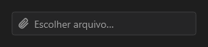

# FileInput



Campo de arquivo: mostra os nomes escolhidos; o clique abre o diálogo do sistema; o "×" limpa. Também aceita arquivos soltos sobre ele.

**Paleta:** Additional · **controle visual** · também tem as [propriedades e eventos comuns a todo controle](controles.md)

## Propriedades

### Aparência

| Propriedade | No Object Inspector | Tipo | O que faz |
|---|---|---|---|
| `placeholder` | Texto de exemplo | texto | O texto apagado mostrado sem arquivo escolhido. |

### Comportamento

| Propriedade | No Object Inspector | Tipo | O que faz |
|---|---|---|---|
| `filter` | Filtro | texto | Os tipos aceitos, como no `OpenDialog` (`Imagens\|*.png;*.jpg\|Todos\|*.*`); vazio: todos. |
| `multiple` | Vários | lógico | Aceita vários arquivos (senão, o novo troca o anterior). |

### Dados

| Propriedade | No Object Inspector | Tipo | O que faz |
|---|---|---|---|
| `files` | Arquivos | texto | Os caminhos escolhidos, separados por `;`; vazio: nenhum. |

## Eventos

| Evento | Quando | No Object Inspector | Pergunta |
|---|---|---|---|
| `on_change` | o valor mudou (pelo usuário ou pelo código) | — |  |
| `on_reject` | — | — |  |

## Em código

No form, o `FileInput1` com o evento ligado (no Object Inspector, na aba Eventos):

```json
{ "class": "FileInput", "name": "FileInput1", "on_change": "file_input1_change" }
```

E o handler, um método do form (`self.FileInput1` já é um `FileInput`):

```rust
impl FrmPrincipal {
    pub fn file_input1_change(&mut self, ui: &mut Ui, _sender: ComponentId, _args: &EventArgs) {
        let atual = self.FileInput1.files(ui);
        self.FileInput1.set_files(ui, format!("{atual}!"));
    }
}
```
