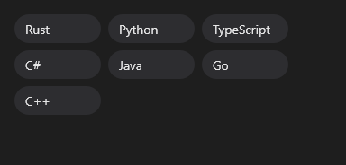

# FlowLayout



Os filhos em fila, no tamanho deles, quebrando a linha quando não cabem (chips, etiquetas, botões de filtro). `h_align` alinha cada linha; `justify` espalha as linhas cheias na largura toda (a última fica à esquerda).

**Paleta:** Layouts · **controle visual** · também tem as [propriedades e eventos comuns a todo controle](controles.md)

## Propriedades

### Posição e tamanho

| Propriedade | No Object Inspector | Tipo | O que faz |
|---|---|---|---|
| `gap` | Espaço entre itens | número | Espaço entre os filhos de uma linha. |
| `line_gap` | Espaço entre linhas | número | Espaço entre uma linha e a seguinte. |
| `h_align` | Alinhamento horizontal | um de: `leading`, `center`, `trailing`, `justify` | Onde cada linha fica na largura: começo, centro, fim ou `justify` (as linhas cheias espalhadas na largura toda; a última fica no começo). |
| `v_align` | Alinhamento vertical | um de: `leading`, `center`, `trailing`, `justify` | Onde cada filho fica na altura da linha (o `align-items`): em cima (o padrão), no meio ou embaixo; o botão mais baixo não sobe mais (L04 do Tabernáculo). Um filho com `grow` toma o espaço que sobra da linha (o espaçador). |
| `baseline` | Alinhar pela linha de base | lógico | Alinha os textos da linha pela linha de base (o `align-items: baseline`): o selo menor fica na mesma base do título. Os sem texto ficam pelo fundo. Vence o `v_align` (L12). |

## Em código

No form, o `FlowLayout1` com o evento ligado (no Object Inspector, na aba Eventos):

```json
{ "class": "FlowLayout", "name": "FlowLayout1" }
```

E o handler, um método do form (`self.FlowLayout1` já é um `FlowLayout`):

```rust
impl FrmPrincipal {
    pub fn form_show(&mut self, ui: &mut Ui, _sender: ComponentId, _args: &EventArgs) {
        let atual = self.FlowLayout1.gap(ui);
        self.FlowLayout1.set_gap(ui, atual + 10.0);
    }
}
```

(Sem eventos próprios: o exemplo usa o `on_show` do form.)
