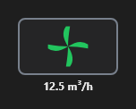

# FlowMeter



Medidor de vazão: a turbina girando na velocidade da vazão e o valor.

**Paleta:** Industrial · **controle visual** · também tem as [propriedades e eventos comuns a todo controle](controles.md)

## Propriedades

### Aparência

| Propriedade | No Object Inspector | Tipo | O que faz |
|---|---|---|---|
| `unit` | Unidade | texto |  |

### Dados

| Propriedade | No Object Inspector | Tipo | O que faz |
|---|---|---|---|
| `value` | Valor | número |  |
| `max` | Máximo | número |  |
| `running` | Ligado | lógico |  |
| `alarm` | Alarme | lógico |  |

## Em código

No form, o `FlowMeter1` com o evento ligado (no Object Inspector, na aba Eventos):

```json
{ "class": "FlowMeter", "name": "FlowMeter1" }
```

E o handler, um método do form (`self.FlowMeter1` já é um `FlowMeter`):

```rust
impl FrmPrincipal {
    pub fn form_show(&mut self, ui: &mut Ui, _sender: ComponentId, _args: &EventArgs) {
        let atual = self.FlowMeter1.value(ui);
        self.FlowMeter1.set_value(ui, atual + 10.0);
    }
}
```

(Sem eventos próprios: o exemplo usa o `on_show` do form.)
