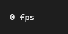

# FpsMeter



Mostra os quadros por segundo (o `Ui::fps`), onde o app quiser. O aylis só desenha quando algo muda: parado, o número cai para 0. Com `live`, o medidor se atualiza duas vezes por segundo (o que já são 2 quadros por segundo).

**Paleta:** Additional · **controle visual** · também tem as [propriedades e eventos comuns a todo controle](controles.md)

## Propriedades

### Aparência

| Propriedade | No Object Inspector | Tipo | O que faz |
|---|---|---|---|
| `format` | Formato | texto | `{0}` vira o número. |

### Comportamento

| Propriedade | No Object Inspector | Tipo | O que faz |
|---|---|---|---|
| `live` | Ao vivo | lógico | Atualiza o número duas vezes por segundo, mesmo sem nada mudando (o que já são 2 quadros por segundo); desligado, só quando a tela é repintada. |

## Em código

No form, o `FpsMeter1` com o evento ligado (no Object Inspector, na aba Eventos):

```json
{ "class": "FpsMeter", "name": "FpsMeter1" }
```

E o handler, um método do form (`self.FpsMeter1` já é um `FpsMeter`):

```rust
impl FrmPrincipal {
    pub fn form_show(&mut self, ui: &mut Ui, _sender: ComponentId, _args: &EventArgs) {
        let atual = self.FpsMeter1.format(ui);
        self.FpsMeter1.set_format(ui, format!("{atual}!"));
    }
}
```

(Sem eventos próprios: o exemplo usa o `on_show` do form.)
