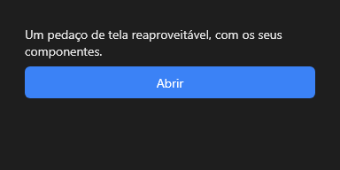

# Frame



Um pedaço de tela reaproveitável (um form dentro de outro), com os seus próprios componentes e eventos.

**Paleta:** Layouts · **controle visual** · também tem as [propriedades e eventos comuns a todo controle](controles.md)

## Propriedades

### Comportamento

| Propriedade | No Object Inspector | Tipo |
|---|---|---|
| `form` | Form | texto |
| `values` | Valores | texto |

## Em código

No form, o `Frame1` com o evento ligado (no Object Inspector, na aba Eventos):

```json
{ "class": "Frame", "name": "Frame1" }
```

E o handler, um método do form (`self.Frame1` já é um `Frame`):

```rust
impl FrmPrincipal {
    pub fn form_show(&mut self, ui: &mut Ui, _sender: ComponentId, _args: &EventArgs) {
        let atual = self.Frame1.form(ui);
        self.Frame1.set_form(ui, format!("{atual}!"));
    }
}
```

(Sem eventos próprios: o exemplo usa o `on_show` do form.)
