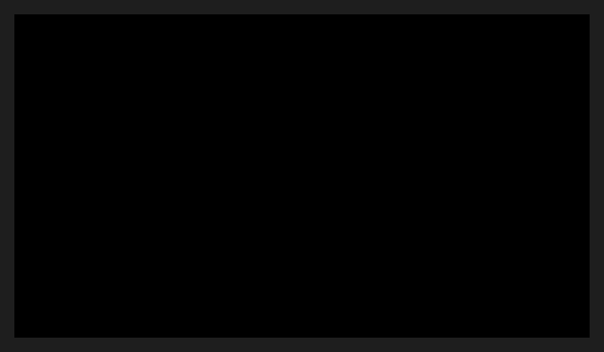

# FrameView



O palco de um player ou de uma prévia que decodifica o vídeo por conta própria: o fundo preto e o último quadro entregue (`FrameView::set_frame`) no retângulo dito, em coordenadas do controle (o decodificador já escalou para o tamanho da tela). `set_shift` desloca o quadro enquanto o próximo não chega (o arrasto de uma vista com zoom). Os gestos (roda, arrasto, clique) chegam pelos eventos comuns (`on_wheel`, `on_pointer_down`...).

**Paleta:** Media · **controle visual** · também tem as [propriedades e eventos comuns a todo controle](controles.md)

## Propriedades

### Aparência

| Propriedade | No Object Inspector | Tipo |
|---|---|---|
| `background` | Fundo | cor |

## Em código

No form, o `FrameView1` com o evento ligado (no Object Inspector, na aba Eventos):

```json
{ "class": "FrameView", "name": "FrameView1" }
```

E o handler, um método do form (`self.FrameView1` já é um `FrameView`):

```rust
impl FrmPrincipal {
    pub fn form_show(&mut self, ui: &mut Ui, _sender: ComponentId, _args: &EventArgs) {
        let _ = &self.FrameView1;
    }
}
```

(Sem eventos próprios: o exemplo usa o `on_show` do form.)
