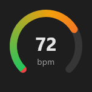

# Gauge



Medidor (o `Gauge` do iOS e do watchOS): arco de 270° com o valor entre `min` e `max`, em gradiente (`gradient` liga as cores verde → amarelo → vermelho); o número e o `label` no meio.

**Paleta:** Additional · **controle visual** · também tem as [propriedades e eventos comuns a todo controle](controles.md)

## Propriedades

### Aparência

| Propriedade | No Object Inspector | Tipo |
|---|---|---|
| `label` | Rótulo | texto |
| `gradient` | Degradê | lógico |

### Dados

| Propriedade | No Object Inspector | Tipo |
|---|---|---|
| `value` | Valor | número |
| `min` | Mínimo | número |
| `max` | Máximo | número |

## Em código

No form, o `Gauge1` com o evento ligado (no Object Inspector, na aba Eventos):

```json
{ "class": "Gauge", "name": "Gauge1" }
```

E o handler, um método do form (`self.Gauge1` já é um `Gauge`):

```rust
impl FrmPrincipal {
    pub fn form_show(&mut self, ui: &mut Ui, _sender: ComponentId, _args: &EventArgs) {
        let atual = self.Gauge1.value(ui);
        self.Gauge1.set_value(ui, atual + 10.0);
    }
}
```

(Sem eventos próprios: o exemplo usa o `on_show` do form.)
