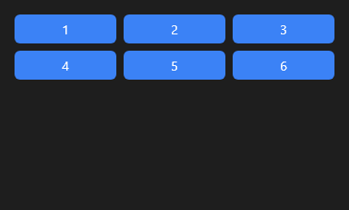

# GridLayout



Grade: os filhos em colunas de mesma largura, linha a linha. Com `columns` = 0 a quantidade de colunas acompanha a largura (cada uma com pelo menos `min_column_width`): a grade responsiva dos cartões. A altura da linha é a do filho mais alto dela (ou `row_height`, se > 0).

**Paleta:** Layouts · **controle visual** · também tem as [propriedades e eventos comuns a todo controle](controles.md)

## Propriedades

### Posição e tamanho

| Propriedade | No Object Inspector | Tipo | O que faz |
|---|---|---|---|
| `columns` | Colunas | inteiro | Quantas colunas; 0: as que couberem na largura (cada uma com `min_column_width`). |
| `min_column_width` | Largura mínima da coluna | número | A menor largura de uma coluna quando `columns` é 0. |
| `gap` | Espaço entre itens | número | Espaço entre as colunas e entre as linhas. |
| `row_height` | Altura da linha | número | Altura fixa de cada linha; 0: a do filho mais alto dela. |

## Em código

No form, o `GridLayout1` com o evento ligado (no Object Inspector, na aba Eventos):

```json
{ "class": "GridLayout", "name": "GridLayout1" }
```

E o handler, um método do form (`self.GridLayout1` já é um `GridLayout`):

```rust
impl FrmPrincipal {
    pub fn form_show(&mut self, ui: &mut Ui, _sender: ComponentId, _args: &EventArgs) {
        let atual = self.GridLayout1.columns(ui);
        self.GridLayout1.set_columns(ui, atual + 1);
    }
}
```

(Sem eventos próprios: o exemplo usa o `on_show` do form.)
