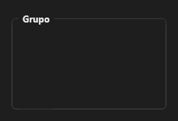

# GroupBox



Moldura com título que agrupa controles.

**Paleta:** Standard · **controle visual** · também tem as [propriedades e eventos comuns a todo controle](controles.md)

## Propriedades

### Aparência

| Propriedade | No Object Inspector | Tipo |
|---|---|---|
| `caption` | Título | texto |

### Teclado

| Propriedade | No Object Inspector | Tipo |
|---|---|---|
| `allowed_chars` | Caracteres permitidos | texto |
| `blocked_chars` | Caracteres bloqueados | texto |
| `only_allowed` | Só os permitidos | lógico |
| `chars_override` | Força os caracteres | lógico |
| `char_map` | Trocas de caracteres | texto |

## Em código

No form, o `GroupBox1` com o evento ligado (no Object Inspector, na aba Eventos):

```json
{ "class": "GroupBox", "name": "GroupBox1" }
```

E o handler, um método do form (`self.GroupBox1` já é um `GroupBox`):

```rust
impl FrmPrincipal {
    pub fn form_show(&mut self, ui: &mut Ui, _sender: ComponentId, _args: &EventArgs) {
        let atual = self.GroupBox1.caption(ui);
        self.GroupBox1.set_caption(ui, format!("{atual}!"));
    }
}
```

(Sem eventos próprios: o exemplo usa o `on_show` do form.)
