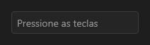

# HotkeyEdit



Campo de tecla de atalho: com o foco, a próxima combinação vira o texto ("Ctrl+Shift+R"). Backspace ou Delete sozinhos limpam. `on_change` a cada troca.

**Paleta:** Additional · **controle visual** · também tem as [propriedades e eventos comuns a todo controle](controles.md)

## Propriedades

### Aparência

| Propriedade | No Object Inspector | Tipo | O que faz |
|---|---|---|---|
| `placeholder` | Texto de exemplo | texto |  |

### Dados

| Propriedade | No Object Inspector | Tipo | O que faz |
|---|---|---|---|
| `hotkey` | Atalho | texto |  |

## Eventos

| Evento | Quando | No Object Inspector | Pergunta |
|---|---|---|---|
| `on_change` | o valor mudou (pelo usuário ou pelo código, como na VCL) | — |  |

## Em código

No form, o `HotkeyEdit1` com o evento ligado (no Object Inspector, na aba Eventos):

```json
{ "class": "HotkeyEdit", "name": "HotkeyEdit1", "on_change": "hotkey_edit1_change" }
```

E o handler, um método do form (`self.HotkeyEdit1` já é um `HotkeyEdit`):

```rust
impl FrmPrincipal {
    pub fn hotkey_edit1_change(&mut self, ui: &mut Ui, _sender: ComponentId, _args: &EventArgs) {
        let atual = self.HotkeyEdit1.hotkey(ui);
        self.HotkeyEdit1.set_hotkey(ui, format!("{atual}!"));
    }
}
```
