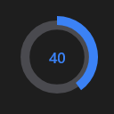

# Knob



O botão giratório (`QKnob`): o valor de `min` a `max` num círculo, que se arrasta com o mouse (ou o dedo), a roda e as setas. `thickness` é a grossura do arco (de 0 a 1 do raio); `show_value` escreve o valor no meio, com `suffix` (`%`, `°C`).

**Paleta:** Quasar · **controle visual** · também tem as [propriedades e eventos comuns a todo controle](controles.md)

## Propriedades

### Aparência

| Propriedade | No Object Inspector | Tipo |
|---|---|---|
| `thickness` | Espessura | número |
| `show_value` | Mostra o valor | lógico |
| `suffix` | Sufixo | texto |

### Comportamento

| Propriedade | No Object Inspector | Tipo |
|---|---|---|
| `read_only` | Somente leitura | lógico |

### Dados

| Propriedade | No Object Inspector | Tipo |
|---|---|---|
| `value` | Valor | número |
| `min` | Mínimo | número |
| `max` | Máximo | número |
| `step` | Passo | número |

## Eventos

| Evento | Quando | No Object Inspector | Pergunta |
|---|---|---|---|
| `on_change` | o valor mudou (pelo usuário ou pelo código, como na VCL) | — |  |

## Em código

No form, o `Knob1` com o evento ligado (no Object Inspector, na aba Eventos):

```json
{ "class": "Knob", "name": "Knob1", "on_change": "knob1_change" }
```

E o handler, um método do form (`self.Knob1` já é um `Knob`):

```rust
impl FrmPrincipal {
    pub fn knob1_change(&mut self, ui: &mut Ui, _sender: ComponentId, _args: &EventArgs) {
        let atual = self.Knob1.value(ui);
        self.Knob1.set_value(ui, atual + 10.0);
    }
}
```
