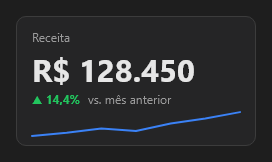

# KpiCard



Cartão de indicador: título, o valor grande, a variação contra o período anterior (▲ verde quando melhora, ▼ vermelho quando piora; `higher_is_better` decide) e a tendência.

**Paleta:** BI · **controle visual** · também tem as [propriedades e eventos comuns a todo controle](controles.md)

## Propriedades

### Aparência

| Propriedade | No Object Inspector | Tipo | O que faz |
|---|---|---|---|
| `title` | Título | texto |  |
| `prefix` | Prefixo | texto |  |
| `suffix` | Sufixo | texto |  |
| `decimals` | Casas decimais | inteiro |  |
| `subtitle` | Subtítulo | texto |  |

### Comportamento

| Propriedade | No Object Inspector | Tipo | O que faz |
|---|---|---|---|
| `higher_is_better` | Maior é melhor | lógico |  |

### Dados

| Propriedade | No Object Inspector | Tipo | O que faz |
|---|---|---|---|
| `value` | Valor | número |  |
| `previous` | Valor anterior | número | O valor do período anterior (para a variação); 0: sem variação. |
| `trend` | Tendência | texto | A tendência, `"10,12,9,15"` (vírgula ou `;`): uma linha embaixo. |

## Em código

No form, o `KpiCard1` com o evento ligado (no Object Inspector, na aba Eventos):

```json
{ "class": "KpiCard", "name": "KpiCard1" }
```

E o handler, um método do form (`self.KpiCard1` já é um `KpiCard`):

```rust
impl FrmPrincipal {
    pub fn form_show(&mut self, ui: &mut Ui, _sender: ComponentId, _args: &EventArgs) {
        let atual = self.KpiCard1.title(ui);
        self.KpiCard1.set_title(ui, format!("{atual}!"));
    }
}
```

(Sem eventos próprios: o exemplo usa o `on_show` do form.)
