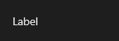

# Label



Texto fixo na tela: um título, uma legenda, a explicação de um campo. Quebra linhas (`wrap`), cresce com o texto (`auto_size`) e segue a fonte e a cor do tema.

**Paleta:** Standard · **controle visual** · também tem as [propriedades e eventos comuns a todo controle](controles.md)

## Propriedades

### Aparência

| Propriedade | No Object Inspector | Tipo | O que faz |
|---|---|---|---|
| `text` | Texto | texto |  |
| `h_align` | Alinhamento horizontal | um de: `leading`, `center`, `trailing`, `justify` |  |
| `v_align` | Alinhamento vertical | um de: `leading`, `center`, `trailing`, `justify` |  |
| `wrap` | Quebra de linha | lógico | Quebra automática de linha. |
| `trimming` | Reticências | um de: `none`, `character`, `word` | Reticências quando não couber: por caractere, por palavra ou nenhuma. |
| `bold` | Negrito | lógico | Negrito (atalho do `font_weight` = `bold`; a fonte em si é a do `ControlBase`: `font_family`, `font_size`...). |
| `color` | Cor | cor | Cor do texto; `None` usa a do tema. |
| `highlight` | Destacar | texto | Trecho a destacar (o `v-highlight`): cada ocorrência, sem diferenciar maiúsculas e acentos, ganha o fundo marcado (cor `highlight` do tema, ou `warning` clara). |
| `letter_spacing` | Espaço entre letras | número | Espaço a mais entre as letras, em pixels (os títulos em caixa-alta espaçados). |
| `text_case` | Maiúsculas/minúsculas | um de: `none`, `upper`, `lower` | Maiúsculas ou minúsculas ao desenhar (o texto não muda). |
| `markup` | Formatação no texto | lógico | O texto traz marcas simples no meio, que viram estilo em vez de aparecer (os textos com HTML simples de um app web): `<b>` negrito, `<sb>` seminegrito, `<i>` itálico, `<u>` sublinhado, `<code>` fonte mono, `<small>` e `<big>` (85% e 120%), `<size=18>`, `<color=text_muted>` (token do tema ou `#rrggbb`) e `<br>` (quebra). Ver `markup_spans`. |
| `outline` | Contorno | cor | Contorno em volta das letras (a legenda sobre vídeo: legível em qualquer fundo). |
| `outline_width` | Largura do contorno | número | Espessura do contorno, em pixels (0 = sem contorno). |
| `line_height` | Altura da linha | número | A altura de cada linha do texto quebrado, em vezes o tamanho da fonte (o `line-height` do CSS); 0: a do estilo (`line_height`) ou a da fonte. O relatório do Tabernáculo, T04. |
| `text_shadow` | Sombra do texto | sombra | Sombra das letras (a legenda sobre vídeo): a cor, o desfoque e o deslocamento (T02). |

### Comportamento

| Propriedade | No Object Inspector | Tipo | O que faz |
|---|---|---|---|
| `focus_control` | Controle do foco | componente | O campo que recebe o foco no Alt+letra do `&` do texto (o `FocusControl` do Delphi). |

## Em código

No form, o `Label1` com o evento ligado (no Object Inspector, na aba Eventos):

```json
{ "class": "Label", "name": "Label1" }
```

E o handler, um método do form (`self.Label1` já é um `Label`):

```rust
impl FrmPrincipal {
    pub fn form_show(&mut self, ui: &mut Ui, _sender: ComponentId, _args: &EventArgs) {
        let atual = self.Label1.text(ui);
        self.Label1.set_text(ui, format!("{atual}!"));
    }
}
```

(Sem eventos próprios: o exemplo usa o `on_show` do form.)
