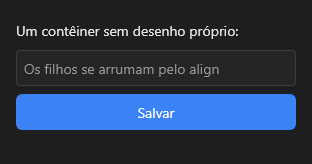

# Layout



Contêiner sem desenho próprio: agrupa os controles e os arruma pelo alinhamento (`align`), margens e espaçamento.

**Paleta:** Layouts · **controle visual** · também tem as [propriedades e eventos comuns a todo controle](controles.md)

## Propriedades

### Teclado

| Propriedade | No Object Inspector | Tipo | O que faz |
|---|---|---|---|
| `allowed_chars` | Caracteres permitidos | texto | Os caracteres dos campos dentro do layout (veja o `Form`). |
| `blocked_chars` | Caracteres bloqueados | texto | Os caracteres que os campos de dentro não aceitam (digitados ou colados); vazio: nenhum. |
| `only_allowed` | Só os permitidos | lógico | Só os caracteres de `allowed_chars` entram nos campos de dentro. |
| `chars_override` | Força os caracteres | lógico | O filtro de caracteres do layout manda nos campos de dentro (sem ele, o do campo decide primeiro). |
| `char_map` | Trocas de caracteres | texto | Trocas do que o teclado produz nos campos de dentro (`",."`: vírgula por ponto), com a mesma herança dos filtros. |

### Posição e tamanho

| Propriedade | No Object Inspector | Tipo | O que faz |
|---|---|---|---|
| `gap` | Espaço entre itens | número | O vão entre os filhos encaixados (o `gap` do CSS). |

## Em código

No form, o `Layout1` com o evento ligado (no Object Inspector, na aba Eventos):

```json
{ "class": "Layout", "name": "Layout1" }
```

E o handler, um método do form (`self.Layout1` já é um `Layout`):

```rust
impl FrmPrincipal {
    pub fn form_show(&mut self, ui: &mut Ui, _sender: ComponentId, _args: &EventArgs) {
        let atual = self.Layout1.allowed_chars(ui);
        self.Layout1.set_allowed_chars(ui, format!("{atual}!"));
    }
}
```

(Sem eventos próprios: o exemplo usa o `on_show` do form.)
