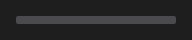

# LevelMeter



Medidor de nível (VU) para áudio: barra de `value` (0 a 1) com as cores do tema (`meter_low` → `meter_mid` → `meter_high`) e marca de pico que cai devagar. `segments` > 0 desenha em gomos (como os medidores de mesa de som).

**Paleta:** Media · **controle visual** · também tem as [propriedades e eventos comuns a todo controle](controles.md)

## Propriedades

### Aparência

| Propriedade | No Object Inspector | Tipo |
|---|---|---|
| `stereo` | Estéreo | lógico |
| `gradient` | Degradê | lógico |
| `dim` | Escurecer | lógico |
| `vertical` | Vertical | lógico |
| `segments` | Segmentos | inteiro |
| `show_peak` | Mostra o pico | lógico |
| `mid` | Limite do meio | número |
| `high` | Limite alto | número |

### Comportamento

| Propriedade | No Object Inspector | Tipo |
|---|---|---|
| `smoothing` | Suavização | número |

### Dados

| Propriedade | No Object Inspector | Tipo |
|---|---|---|
| `value` | Valor | número |
| `value_right` | Valor da direita | número |
| `muted` | Mudo | lógico |

## Em código

No form, o `LevelMeter1` com o evento ligado (no Object Inspector, na aba Eventos):

```json
{ "class": "LevelMeter", "name": "LevelMeter1" }
```

E o handler, um método do form (`self.LevelMeter1` já é um `LevelMeter`):

```rust
impl FrmPrincipal {
    pub fn form_show(&mut self, ui: &mut Ui, _sender: ComponentId, _args: &EventArgs) {
        let atual = self.LevelMeter1.value(ui);
        self.LevelMeter1.set_value(ui, atual + 10.0);
    }
}
```

(Sem eventos próprios: o exemplo usa o `on_show` do form.)
