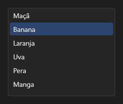

# ListBox



Lista de opções: `items` separados por `;`, `item_index` escolhido. Setas, Home/End, PageUp/PageDown e a roda navegam; `on_change` traz o texto e `on_dbl_click` funciona como sempre.

**Paleta:** Standard · **controle visual** · também tem as [propriedades e eventos comuns a todo controle](controles.md)

## Propriedades

### Aparência

| Propriedade | No Object Inspector | Tipo | O que faz |
|---|---|---|---|
| `item_height` | Altura do item | número | Altura de cada linha, em pontos. |

### Comportamento

| Propriedade | No Object Inspector | Tipo | O que faz |
|---|---|---|---|
| `overscroll` | Fim da rolagem | um de: `auto`, `glow`, `stretch`, `bounce`, `none` | O efeito de fim da rolagem no toque (`auto`: o do sistema; veja `aylis_core::overscroll`). |
| `multi_select` | Seleção múltipla | lógico | Escolhe vários (Ctrl+clique, Shift+clique, Ctrl+A); os escolhidos ficam em `selected`. |

### Dados

| Propriedade | No Object Inspector | Tipo | O que faz |
|---|---|---|---|
| `items` | Itens | texto | Os itens, separados por `;`. |
| `item_index` | Item escolhido | inteiro | O item escolhido (o atual, com `multi_select`), a partir de 0; -1: nenhum. |
| `selected` | Escolhidos | texto | Os índices escolhidos com `multi_select`, separados por `;` (`"1;4;5"`); vazio: nenhum. |

## Eventos

| Evento | Quando | No Object Inspector | Pergunta |
|---|---|---|---|
| `on_change` | o valor mudou (pelo usuário ou pelo código) | — |  |

## Em código

No form, o `ListBox1` com o evento ligado (no Object Inspector, na aba Eventos):

```json
{ "class": "ListBox", "name": "ListBox1", "on_change": "list_box1_change" }
```

E o handler, um método do form (`self.ListBox1` já é um `ListBox`):

```rust
impl FrmPrincipal {
    pub fn list_box1_change(&mut self, ui: &mut Ui, _sender: ComponentId, _args: &EventArgs) {
        let atual = self.ListBox1.items(ui);
        self.ListBox1.set_items(ui, format!("{atual}!"));
    }
}
```
