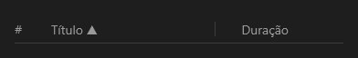

# ListHeader



O cabeçalho de uma lista.

**Paleta:** Additional · **controle visual** · também tem as [propriedades e eventos comuns a todo controle](controles.md)

## Propriedades

### Comportamento

| Propriedade | No Object Inspector | Tipo | O que faz |
|---|---|---|---|
| `list` | Lista | componente | O `VirtualList` (ou `DataRepeater`) que o cabeçalho acompanha. |

### Dados

| Propriedade | No Object Inspector | Tipo | O que faz |
|---|---|---|---|
| `columns` | Colunas | lista de `HeaderColumn` | As colunas: a lista de `HEADER_COLUMN` em JSON. |
| `sort_part` | Coluna da ordem | texto | A coluna da ordem de agora (o `part`; vazio: nenhuma): a seta aparece nela. |
| `sort_descending` | Ordem decrescente | lógico | A ordem da coluna `sort_part` é decrescente (a seta para baixo). |

## Eventos

| Evento | Quando | No Object Inspector | Pergunta |
|---|---|---|---|
| `on_sort` | — | — |  |
| `on_column_resize` | — | — |  |

## Em código

No form, o `ListHeader1` com o evento ligado (no Object Inspector, na aba Eventos):

```json
{ "class": "ListHeader", "name": "ListHeader1", "on_sort": "list_header1_sort" }
```

E o handler, um método do form (`self.ListHeader1` já é um `ListHeader`):

```rust
impl FrmPrincipal {
    pub fn list_header1_sort(&mut self, ui: &mut Ui, _sender: ComponentId, _args: &EventArgs) {
        let atual = self.ListHeader1.sort_part(ui);
        self.ListHeader1.set_sort_part(ui, format!("{atual}!"));
    }
}
```

## Mais sobre o ListHeader

### Alinhar às linhas sem impor colunas

Ligue o `list` num `VirtualList` (ou `DataRepeater`) e diga, em `columns`, o título e o
componente do modelo de cada coluna (`part`). O título fica onde o componente está na primeira
linha à vista; a linha que não tem o componente, ou o esconde, não participa.

```json
{"class": "ListHeader", "name": "hdrMusicas", "list": "lstMusicas", "align": "top", "columns": [
  {"title": "#", "part": "lblNumero", "width": 40},
  {"title": "Título", "part": "lblTitulo", "width": 260, "sortable": true, "resizable": true},
  {"title": "Duração", "part": "lblDuracao", "width": 72, "align": "right"}]}
```

Arrastar a divisa muda a largura do componente em todas as linhas (`on_column_resize` avisa).
O clique num título com `sortable` troca a ordem e avisa o `on_sort` com o `part`: o app
ordena os dados e chama o `refresh` da lista (`sort_part` e `sort_descending` mostram a seta).
