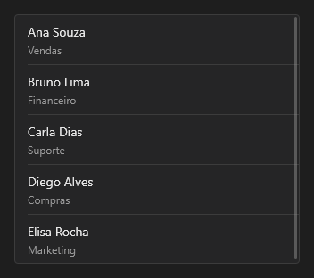

# ListView



Lista de itens com título, detalhe e imagem opcional, pensada também para o celular (linhas altas, rolagem com o dedo). `items` no texto: `Título|detalhe;Outro|mais`. `on_change` traz o índice; `on_item_click` também.

**Paleta:** Additional · **controle visual** · também tem as [propriedades e eventos comuns a todo controle](controles.md)

## Propriedades

### Aparência

| Propriedade | No Object Inspector | Tipo | O que faz |
|---|---|---|---|
| `item_height` | Altura do item | número | Altura de cada linha, em pontos. |
| `accessory` | Seta à direita | lógico | Seta › à direita de cada item (navegação). |

### Dados

| Propriedade | No Object Inspector | Tipo | O que faz |
|---|---|---|---|
| `items` | Itens | texto | Os itens, separados por `;`, cada um `Título\|detalhe` (o detalhe é opcional). |
| `item_index` | Item escolhido | inteiro | O item escolhido, a partir de 0; -1: nenhum. |

## Eventos

| Evento | Quando | No Object Inspector | Pergunta |
|---|---|---|---|
| `on_change` | o valor mudou (pelo usuário ou pelo código) | — |  |
| `on_item_click` | — | — |  |

## Em código

No form, o `ListView1` com o evento ligado (no Object Inspector, na aba Eventos):

```json
{ "class": "ListView", "name": "ListView1", "on_change": "list_view1_change" }
```

E o handler, um método do form (`self.ListView1` já é um `ListView`):

```rust
impl FrmPrincipal {
    pub fn list_view1_change(&mut self, ui: &mut Ui, _sender: ComponentId, _args: &EventArgs) {
        let atual = self.ListView1.items(ui);
        self.ListView1.set_items(ui, format!("{atual}!"));
    }
}
```
