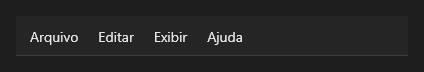

# MainMenu



Barra de menu, normalmente `align: top`.

**Paleta:** Menus · **controle visual** · também tem as [propriedades e eventos comuns a todo controle](controles.md)

## Propriedades

Só as comuns.

## Eventos

| Evento | Quando | No Object Inspector | Pergunta |
|---|---|---|---|
| `on_item_click` | — | — |  |

## Em código

No form, o `MainMenu1` com o evento ligado (no Object Inspector, na aba Eventos):

```json
{ "class": "MainMenu", "name": "MainMenu1", "on_item_click": "main_menu1_item_click" }
```

E o handler, um método do form (`self.MainMenu1` já é um `MainMenu`):

```rust
impl FrmPrincipal {
    pub fn main_menu1_item_click(&mut self, ui: &mut Ui, _sender: ComponentId, _args: &EventArgs) {
        let _ = &self.MainMenu1;
    }
}
```
