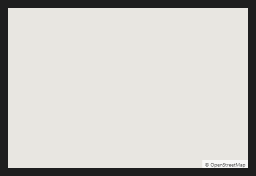

# MapView



Mapa interativo de blocos (como os mapas da web): arrastar, aproximar com a roda e marcadores nas coordenadas.

**Paleta:** Additional · **controle visual** · também tem as [propriedades e eventos comuns a todo controle](controles.md)

## Propriedades

### Dados

| Propriedade | No Object Inspector | Tipo | O que faz |
|---|---|---|---|
| `latitude` | Latitude | número | A latitude do centro do mapa, em graus (negativa ao sul). |
| `longitude` | Longitude | número | A longitude do centro do mapa, em graus (negativa a oeste). |
| `zoom` | Zoom | número | 1 (o mundo) a 19 (a rua); pode ser fracionário. |
| `markers` | Marcadores | texto | Marcadores: `lat,lon,rótulo` separados por `;`. |
| `provider` | Provedor | componente | Quem fornece os blocos (um provedor de mapa, item 25): o endereço e o crédito são os dele; sem ele, os do OpenStreetMap (`TileServer`). |

## Eventos

| Evento | Quando | No Object Inspector | Pergunta |
|---|---|---|---|
| `on_move` | — | — |  |
| `on_map_click` | — | — |  |

## Em código

No form, o `MapView1` com o evento ligado (no Object Inspector, na aba Eventos):

```json
{ "class": "MapView", "name": "MapView1", "on_move": "map_view1_move" }
```

E o handler, um método do form (`self.MapView1` já é um `MapView`):

```rust
impl FrmPrincipal {
    pub fn map_view1_move(&mut self, ui: &mut Ui, _sender: ComponentId, _args: &EventArgs) {
        let atual = self.MapView1.latitude(ui);
        self.MapView1.set_latitude(ui, atual + 10.0);
    }
}
```
