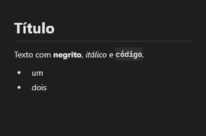

# Markdown



Mostra texto em Markdown com as cores e fontes do tema: títulos, listas, tabelas, código realçado, imagens e links, com seleção e cópia.

**Paleta:** Additional · **controle visual** · também tem as [propriedades e eventos comuns a todo controle](controles.md)

## Propriedades

### Aparência

| Propriedade | No Object Inspector | Tipo | O que faz |
|---|---|---|---|
| `editor_look` | Código como no editor | lógico | Os blocos de código com a cara do editor (liga o `EditorCode` com as duas de baixo). |
| `code_theme` | Tema do código | texto | O tema de cores dos blocos com a cara do editor (vazio: o do app). |
| `code_language` | Linguagem do código | texto | A linguagem dos blocos sem linguagem na cerca (`rust`, `python`...). |

### Dados

| Propriedade | No Object Inspector | Tipo | O que faz |
|---|---|---|---|
| `text` | Texto | texto |  |
| `source` | Origem | texto |  |
| `anchor` | Âncora | texto | O título para onde rolar: o identificador (`gravar-no-banco`, com ou sem `#`) ou o texto dele (o "Nesta página" de uma documentação, um link `pagina.md#secao`). |
| `highlight` | Destacar | texto | O texto a destacar na página (sem diferença de maiúsculas), como o achado de uma busca: cada ocorrência ganha um fundo, e a página rola até a primeira. |

## Eventos

| Evento | Quando | No Object Inspector | Pergunta |
|---|---|---|---|
| `on_link` | — | — |  |

## Em código

No form, o `Markdown1` com o evento ligado (no Object Inspector, na aba Eventos):

```json
{ "class": "Markdown", "name": "Markdown1", "on_link": "markdown1_link" }
```

E o handler, um método do form (`self.Markdown1` já é um `Markdown`):

```rust
impl FrmPrincipal {
    pub fn markdown1_link(&mut self, ui: &mut Ui, _sender: ComponentId, _args: &EventArgs) {
        let atual = self.Markdown1.text(ui);
        self.Markdown1.set_text(ui, format!("{atual}!"));
    }
}
```
