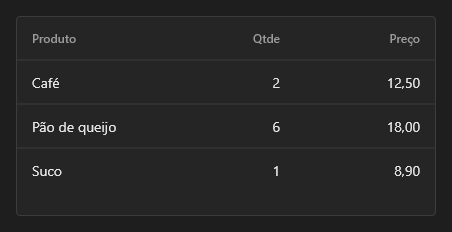

# MarkupTable



A tabela simples (`QMarkupTable`): `columns` com os títulos (`Nome;Idade;Cidade`) e `rows` com uma linha por linha de texto (as células separadas por `;`). Os números ficam à direita. `dense` aperta as linhas, `striped` alterna o fundo e `separator` escolhe as linhas de separação. Para dados de banco, use o `DataGrid`.

**Paleta:** Quasar · **controle visual** · também tem as [propriedades e eventos comuns a todo controle](controles.md)

## Propriedades

### Aparência

| Propriedade | No Object Inspector | Tipo | O que faz |
|---|---|---|---|
| `dense` | Compacto | lógico | Linhas mais baixas (28 pontos em vez de 44). |
| `striped` | Listrado | lógico | Alterna o fundo das linhas (zebrado). |
| `separator` | Separadores | um de: `horizontal`, `vertical`, `cell`, `none` | As linhas de separação: horizontais, verticais, em volta de cada célula ou nenhuma. |

### Dados

| Propriedade | No Object Inspector | Tipo | O que faz |
|---|---|---|---|
| `columns` | Colunas | texto | Os títulos das colunas, separados por `;` (`Nome;Idade;Cidade`). |
| `rows` | Linhas | texto | As linhas da tabela, uma por linha de texto, com as células separadas por `;`. |

## Em código

No form, o `MarkupTable1` com o evento ligado (no Object Inspector, na aba Eventos):

```json
{ "class": "MarkupTable", "name": "MarkupTable1" }
```

E o handler, um método do form (`self.MarkupTable1` já é um `MarkupTable`):

```rust
impl FrmPrincipal {
    pub fn form_show(&mut self, ui: &mut Ui, _sender: ComponentId, _args: &EventArgs) {
        let atual = self.MarkupTable1.columns(ui);
        self.MarkupTable1.set_columns(ui, format!("{atual}!"));
    }
}
```

(Sem eventos próprios: o exemplo usa o `on_show` do form.)
