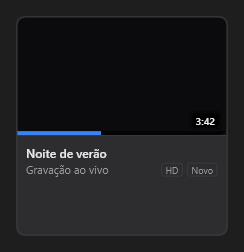

# MediaCard



O cartão de um item de uma biblioteca de mídia (vídeos, fotos, gravações).

**Paleta:** Media · **controle visual** · também tem as [propriedades e eventos comuns a todo controle](controles.md)

## Propriedades

### Aparência

| Propriedade | No Object Inspector | Tipo | O que faz |
|---|---|---|---|
| `title` | Título | texto | O nome do item, embaixo da miniatura. |
| `subtitle` | Subtítulo | texto | A linha menor embaixo do título (tamanho, data). |
| `duration` | Duração | texto | A duração no canto de baixo da miniatura (`"02:15"`); vazio: nenhuma. |
| `badges` | Selos | texto | Os selos à direita do subtítulo, separados por `;` (`*` na frente destaca, `icon:nome` é um ícone). |
| `icon` | Ícone | texto | O ícone no meio quando não há miniatura (e à esquerda no `compact`). |
| `compact` | Compacto | lógico | A linha de uma pasta: o ícone à esquerda, o título e o subtítulo ao lado. |
| `dimmed` | Apagado | lógico | Aparece apagado (recortado, esperando colar). |
| `highlighted` | Destacado | lógico | Um alvo de soltar marcado (a pasta sob o item arrastado). |

### Comportamento

| Propriedade | No Object Inspector | Tipo | O que faz |
|---|---|---|---|
| `selection_mode` | Modo de seleção | lógico | A caixa da seleção sempre à vista (não só com o mouse em cima). |
| `editable_title` | Nome editável | lógico | O clique no nome abre o campo de renomear (em vez do `on_click`); o nome novo vem no `on_rename`. |

### Dados

| Propriedade | No Object Inspector | Tipo | O que faz |
|---|---|---|---|
| `selected` | Escolhidos | lógico | Marcado (a caixa da seleção aparece preenchida). |
| `order` | Ordem | inteiro | O número da ordem mostrado na caixa da seleção; 0: nenhum. |
| `progress` | Progresso | número | A barra de progresso sobre a miniatura, de 0 a 1; negativo: sem barra. |
| `progress_text` | Texto do progresso | texto | O texto junto da barra de progresso. |

## Eventos

| Evento | Quando | No Object Inspector | Pergunta |
|---|---|---|---|
| `on_select` | — | — |  |
| `on_context` | — | — |  |
| `on_rename` | — | — |  |

## Em código

No form, o `MediaCard1` com o evento ligado (no Object Inspector, na aba Eventos):

```json
{ "class": "MediaCard", "name": "MediaCard1", "on_select": "media_card1_select" }
```

E o handler, um método do form (`self.MediaCard1` já é um `MediaCard`):

```rust
impl FrmPrincipal {
    pub fn media_card1_select(&mut self, ui: &mut Ui, _sender: ComponentId, _args: &EventArgs) {
        let atual = self.MediaCard1.title(ui);
        self.MediaCard1.set_title(ui, format!("{atual}!"));
    }
}
```

## Mais sobre o MediaCard

### Duas áreas de clique

A caixa de seleção dispara `on_select`; o resto do card, `on_click`. Com `editable_title`,
o nome vira uma terceira área: o clique nele abre o campo de renomear em vez do `on_click`
(a miniatura continua abrindo o item).

### editable_title

O card cuida sozinho do campo: abre sobre o nome, com ele todo selecionado. Enter, Tab ou
o clique fora grava no `title` e dispara `on_rename` com o nome novo (sem espaços nas
pontas; vazio ou igual ao atual não dispara); Esc cancela. O app só grava o nome:

```rust
pub fn card_rename(&mut self, ui: &mut Ui, _sender: ComponentId, args: &EventArgs) -> Result<()> {
    let novo = args.text().unwrap_or_default();
    biblioteca::renomear(&self.item_atual, novo)?;
    Ok(())
}
```

Se a gravação falhar, devolva o erro e ponha o `title` antigo de volta.

### rename

O método `rename()` abre o campo pelo código, mesmo sem `editable_title`: é o F2 do app.
