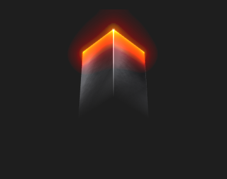

# Model3D



Modelo 3D (glTF 2.0 / GLB) com esqueleto, morph targets e animação.

**Paleta:** 3D · **controle visual** · também tem as [propriedades e eventos comuns a todo controle](controles.md)

## Propriedades

### Animação

| Propriedade | No Object Inspector | Tipo |
|---|---|---|
| `animation` | Animação | texto |
| `playing` | Tocando | lógico |
| `looping` | Repetindo | lógico |
| `speed` | Velocidade | número |
| `crossfade` | Transição suave | duração (ms) |
| `auto_rotate` | Gira sozinho | número |

### Aparência

| Propriedade | No Object Inspector | Tipo |
|---|---|---|
| `file_lights` | Luzes do arquivo | lógico |
| `shadows` | Sombras | lógico |
| `ray_traced` | Traçado de raios | lógico |
| `background` | Fundo | cor |
| `resolution` | Resolução do 3D | número |

### Comportamento

| Propriedade | No Object Inspector | Tipo |
|---|---|---|
| `orbit` | Girar com o mouse | lógico |

### Dados

| Propriedade | No Object Inspector | Tipo |
|---|---|---|
| `source` | Origem | texto |

### Posição e tamanho

| Propriedade | No Object Inspector | Tipo |
|---|---|---|
| `yaw` | Giro horizontal | ângulo (graus) |
| `pitch` | Inclinação | ângulo (graus) |
| `zoom` | Zoom | número |
| `model_rotation` | Rotação do modelo | ângulo (graus) |
| `camera` | Câmera | texto |

## Eventos

| Evento | Quando | No Object Inspector | Pergunta |
|---|---|---|---|
| `on_clip_end` | — | — |  |

## Em código

No form, o `Model3D1` com o evento ligado (no Object Inspector, na aba Eventos):

```json
{ "class": "Model3D", "name": "Model3D1", "on_clip_end": "model3_d1_clip_end" }
```

E o handler, um método do form (`self.Model3D1` já é um `Model3D`):

```rust
impl FrmPrincipal {
    pub fn model3_d1_clip_end(&mut self, ui: &mut Ui, _sender: ComponentId, _args: &EventArgs) {
        let atual = self.Model3D1.source(ui);
        self.Model3D1.set_source(ui, format!("{atual}!"));
    }
}
```
