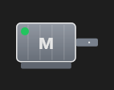

# Motor



Motor de supervisório: o símbolo com o estado (ligado, desligado, em alarme) nas cores da indústria.

**Paleta:** Industrial · **controle visual** · também tem as [propriedades e eventos comuns a todo controle](controles.md)

## Propriedades

### Aparência

| Propriedade | No Object Inspector | Tipo |
|---|---|---|
| `label` | Rótulo | texto |

### Comportamento

| Propriedade | No Object Inspector | Tipo |
|---|---|---|
| `speed` | Velocidade | número |

### Dados

| Propriedade | No Object Inspector | Tipo |
|---|---|---|
| `running` | Ligado | lógico |
| `alarm` | Alarme | lógico |

## Em código

No form, o `Motor1` com o evento ligado (no Object Inspector, na aba Eventos):

```json
{ "class": "Motor", "name": "Motor1" }
```

E o handler, um método do form (`self.Motor1` já é um `Motor`):

```rust
impl FrmPrincipal {
    pub fn form_show(&mut self, ui: &mut Ui, _sender: ComponentId, _args: &EventArgs) {
        let atual = self.Motor1.running(ui);
        self.Motor1.set_running(ui, !atual);
    }
}
```

(Sem eventos próprios: o exemplo usa o `on_show` do form.)
