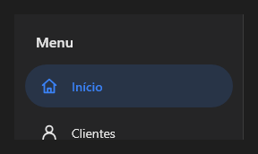

# NavigationDrawer



Gaveta de navegação: fica à esquerda (`align` Left), aberta ou fechada (`open`); fechada em modo `rail` mostra só os ícones. Com `items`/`icons` desenha a lista de destinos (`item_index`, `on_change`); também aceita controles dentro.

**Paleta:** Layouts · **controle visual** · também tem as [propriedades e eventos comuns a todo controle](controles.md)

## Propriedades

### Aparência

| Propriedade | No Object Inspector | Tipo | O que faz |
|---|---|---|---|
| `title` | Título | texto | O título no topo da gaveta aberta; vazio: sem título. |
| `icons` | Ícones | texto | Os ícones dos destinos, na mesma ordem, separados por `;`. |

### Comportamento

| Propriedade | No Object Inspector | Tipo | O que faz |
|---|---|---|---|
| `open` | Aberto | lógico | Aberta (na largura `drawer_width`); fechada some ou, com `rail`, fica só com os ícones. |
| `rail` | Só ícones | lógico | Fechada, mostra a faixa estreita só com os ícones (na largura `rail_width`) em vez de sumir. |

### Dados

| Propriedade | No Object Inspector | Tipo | O que faz |
|---|---|---|---|
| `items` | Itens | texto | Os destinos da lista, separados por `;`. |
| `item_index` | Item escolhido | inteiro | O destino escolhido (a partir de 0); -1: nenhum. |

### Posição e tamanho

| Propriedade | No Object Inspector | Tipo | O que faz |
|---|---|---|---|
| `drawer_width` | Largura da gaveta | número | A largura aberta, em pontos. |
| `rail_width` | Largura só com ícones | número | A largura fechada em modo `rail`, em pontos. |

## Eventos

| Evento | Quando | No Object Inspector | Pergunta |
|---|---|---|---|
| `on_change` | o valor mudou (pelo usuário ou pelo código) | — |  |

## Em código

No form, o `NavigationDrawer1` com o evento ligado (no Object Inspector, na aba Eventos):

```json
{ "class": "NavigationDrawer", "name": "NavigationDrawer1", "on_change": "navigation_drawer1_change" }
```

E o handler, um método do form (`self.NavigationDrawer1` já é um `NavigationDrawer`):

```rust
impl FrmPrincipal {
    pub fn navigation_drawer1_change(&mut self, ui: &mut Ui, _sender: ComponentId, _args: &EventArgs) {
        let atual = self.NavigationDrawer1.open(ui);
        self.NavigationDrawer1.set_open(ui, !atual);
    }
}
```
