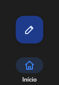

# NavigationRail



Trilho de navegação (o "navigation rail" do Material 3, para telas largas): ícones com o nome embaixo, o escolhido com a pílula; um FAB opcional em cima (`fab_icon`, `on_fab`). `item_index`, `on_change`.

**Paleta:** Layouts · **controle visual** · também tem as [propriedades e eventos comuns a todo controle](controles.md)

## Propriedades

### Aparência

| Propriedade | No Object Inspector | Tipo |
|---|---|---|
| `icons` | Ícones | texto |
| `fab_icon` | Ícone do botão flutuante | texto |

### Dados

| Propriedade | No Object Inspector | Tipo |
|---|---|---|
| `items` | Itens | texto |
| `item_index` | Item escolhido | inteiro |

## Eventos

| Evento | Quando | No Object Inspector | Pergunta |
|---|---|---|---|
| `on_change` | o valor mudou (pelo usuário ou pelo código, como na VCL) | — |  |
| `on_fab` | — | — |  |

## Em código

No form, o `NavigationRail1` com o evento ligado (no Object Inspector, na aba Eventos):

```json
{ "class": "NavigationRail", "name": "NavigationRail1", "on_change": "navigation_rail1_change" }
```

E o handler, um método do form (`self.NavigationRail1` já é um `NavigationRail`):

```rust
impl FrmPrincipal {
    pub fn navigation_rail1_change(&mut self, ui: &mut Ui, _sender: ComponentId, _args: &EventArgs) {
        let atual = self.NavigationRail1.items(ui);
        self.NavigationRail1.set_items(ui, format!("{atual}!"));
    }
}
```
