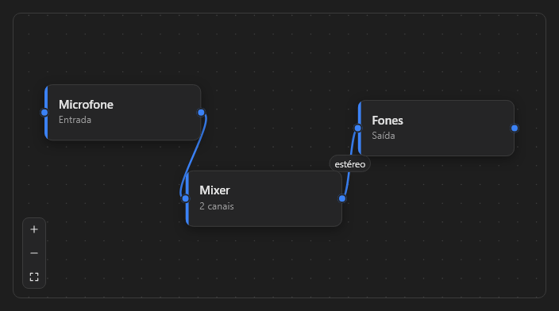

# NodeGraph



Editor de nós ligados por cabos: fluxos, roteamento de áudio, automações. Arrastar os nós, ligar as portas e aproximar.

**Paleta:** Additional · **controle visual** · também tem as [propriedades e eventos comuns a todo controle](controles.md)

## Propriedades

### Aparência

| Propriedade | No Object Inspector | Tipo | O que faz |
|---|---|---|---|
| `show_grid` | Mostra a grade | lógico |  |

### Comportamento

| Propriedade | No Object Inspector | Tipo | O que faz |
|---|---|---|---|
| `snap` | Passo com Shift | lógico | Encaixe na grade ao soltar um nó. |

## Eventos

| Evento | Quando | No Object Inspector | Pergunta |
|---|---|---|---|
| `on_node_click` | — | — |  |
| `on_node_moved` | — | — |  |
| `on_cable_click` | — | — |  |
| `on_cable_delete` | — | — |  |
| `on_connect` | — | — |  |
| `on_pane_click` | — | — |  |

## Em código

No form, o `NodeGraph1` com o evento ligado (no Object Inspector, na aba Eventos):

```json
{ "class": "NodeGraph", "name": "NodeGraph1", "on_node_click": "node_graph1_node_click" }
```

E o handler, um método do form (`self.NodeGraph1` já é um `NodeGraph`):

```rust
impl FrmPrincipal {
    pub fn node_graph1_node_click(&mut self, ui: &mut Ui, _sender: ComponentId, _args: &EventArgs) {
        let atual = self.NodeGraph1.snap(ui);
        self.NodeGraph1.set_snap(ui, !atual);
    }
}
```
