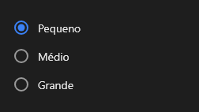

# OptionGroup



O grupo de opções (`QOptionGroup`): `items` (`Pequeno;Médio;Grande`) como botões de rádio (uma escolha, `item_index`), caixas ou interruptores (várias, os textos marcados em `selected`, separados por `;`). `inline` põe lado a lado. `on_change` a cada mudança.

**Paleta:** Quasar · **controle visual** · também tem as [propriedades e eventos comuns a todo controle](controles.md)

## Propriedades

### Aparência

| Propriedade | No Object Inspector | Tipo | O que faz |
|---|---|---|---|
| `inline` | Na mesma linha | lógico |  |

### Comportamento

| Propriedade | No Object Inspector | Tipo | O que faz |
|---|---|---|---|
| `kind` | Tipo | um de: `radio`, `checkbox`, `toggle` |  |

### Dados

| Propriedade | No Object Inspector | Tipo | O que faz |
|---|---|---|---|
| `items` | Itens | texto |  |
| `item_index` | Item escolhido | inteiro |  |
| `selected` | Escolhidos | texto |  |

## Eventos

| Evento | Quando | No Object Inspector | Pergunta |
|---|---|---|---|
| `on_change` | o valor mudou (pelo usuário ou pelo código, como na VCL) | — |  |

## Em código

No form, o `OptionGroup1` com o evento ligado (no Object Inspector, na aba Eventos):

```json
{ "class": "OptionGroup", "name": "OptionGroup1", "on_change": "option_group1_change" }
```

E o handler, um método do form (`self.OptionGroup1` já é um `OptionGroup`):

```rust
impl FrmPrincipal {
    pub fn option_group1_change(&mut self, ui: &mut Ui, _sender: ComponentId, _args: &EventArgs) {
        let atual = self.OptionGroup1.items(ui);
        self.OptionGroup1.set_items(ui, format!("{atual}!"));
    }
}
```
