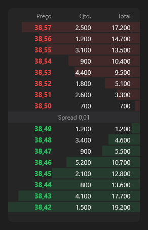

# OrderBook



Livro de ofertas: as vendas (`asks`, do menor preço para cima) em cima, as compras (`bids`) embaixo, o spread no meio; a barra de cada linha mostra o acumulado. Clique numa linha: `on_price_click` com o preço (para a boleta).

**Paleta:** Trader · **controle visual** · também tem as [propriedades e eventos comuns a todo controle](controles.md)

## Propriedades

### Aparência

| Propriedade | No Object Inspector | Tipo | O que faz |
|---|---|---|---|
| `levels` | Níveis | inteiro |  |
| `decimals` | Casas decimais | inteiro |  |

### Dados

| Propriedade | No Object Inspector | Tipo | O que faz |
|---|---|---|---|
| `bids` | Ofertas de compra | texto | `"38.50:1200;38.49:800"` (preço:quantidade). |
| `asks` | Ofertas de venda | texto |  |

## Eventos

| Evento | Quando | No Object Inspector | Pergunta |
|---|---|---|---|
| `on_price_click` | — | — |  |

## Em código

No form, o `OrderBook1` com o evento ligado (no Object Inspector, na aba Eventos):

```json
{ "class": "OrderBook", "name": "OrderBook1", "on_price_click": "order_book1_price_click" }
```

E o handler, um método do form (`self.OrderBook1` já é um `OrderBook`):

```rust
impl FrmPrincipal {
    pub fn order_book1_price_click(&mut self, ui: &mut Ui, _sender: ComponentId, _args: &EventArgs) {
        let atual = self.OrderBook1.bids(ui);
        self.OrderBook1.set_bids(ui, format!("{atual}!"));
    }
}
```
