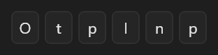

# OtpInput



Código de verificação (o `v-otp-input`): `length` caixas de um caractere. `text` é o código; `on_complete` quando todas as caixas estão cheias. `digits` aceita só números.

**Paleta:** Additional · **controle visual** · também tem as [propriedades e eventos comuns a todo controle](controles.md)

## Propriedades

### Comportamento

| Propriedade | No Object Inspector | Tipo | O que faz |
|---|---|---|---|
| `length` | Comprimento | inteiro | Quantas caixas (caracteres) o código tem. |
| `digits` | Só números | lógico | Só aceita números. |
| `password` | Senha (esconde o texto) | lógico | Mostra `•` no lugar dos caracteres. |

### Dados

| Propriedade | No Object Inspector | Tipo | O que faz |
|---|---|---|---|
| `text` | Texto | texto | O código digitado até agora. |

## Eventos

| Evento | Quando | No Object Inspector | Pergunta |
|---|---|---|---|
| `on_change` | o valor mudou (pelo usuário ou pelo código) | — |  |
| `on_complete` | — | — |  |

## Em código

No form, o `OtpInput1` com o evento ligado (no Object Inspector, na aba Eventos):

```json
{ "class": "OtpInput", "name": "OtpInput1", "on_change": "otp_input1_change" }
```

E o handler, um método do form (`self.OtpInput1` já é um `OtpInput`):

```rust
impl FrmPrincipal {
    pub fn otp_input1_change(&mut self, ui: &mut Ui, _sender: ComponentId, _args: &EventArgs) {
        let atual = self.OtpInput1.text(ui);
        self.OtpInput1.set_text(ui, format!("{atual}!"));
    }
}
```
