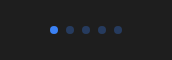

# PageControl



Pontos de página (o "page control" do iOS): `count` pontos, o atual (`index`) destacado; clicar num lado anda uma página (`on_change`). No iOS 26 fica numa cápsula de vidro; no Material, o atual vira um traço.

**Paleta:** Additional · **controle visual** · também tem as [propriedades e eventos comuns a todo controle](controles.md)

## Propriedades

### Dados

| Propriedade | No Object Inspector | Tipo | O que faz |
|---|---|---|---|
| `count` | Quantidade | inteiro | Quantas páginas (pontos); 0: não desenha nada. |
| `index` | Índice | inteiro | A página atual (0 = a primeira), destacada. |

## Eventos

| Evento | Quando | No Object Inspector | Pergunta |
|---|---|---|---|
| `on_change` | o valor mudou (pelo usuário ou pelo código) | — |  |

## Em código

No form, o `PageControl1` com o evento ligado (no Object Inspector, na aba Eventos):

```json
{ "class": "PageControl", "name": "PageControl1", "on_change": "page_control1_change" }
```

E o handler, um método do form (`self.PageControl1` já é um `PageControl`):

```rust
impl FrmPrincipal {
    pub fn page_control1_change(&mut self, ui: &mut Ui, _sender: ComponentId, _args: &EventArgs) {
        let atual = self.PageControl1.count(ui);
        self.PageControl1.set_count(ui, atual + 1);
    }
}
```
