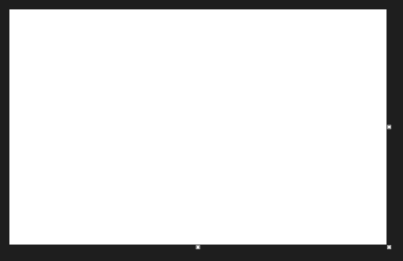

# PaintCanvas



Uma imagem para desenhar com o mouse (o Paint).

**Paleta:** Additional · **controle visual** · também tem as [propriedades e eventos comuns a todo controle](controles.md)

## Propriedades

### Aparência

| Propriedade | No Object Inspector | Tipo | O que faz |
|---|---|---|---|
| `color` | Cor | cor | Cor 1 (botão esquerdo). |
| `back_color` | Cor de fundo | cor | Cor 2 (botão direito, borracha e preenchimento das formas). |
| `zoom` | Zoom | número |  |

### Comportamento

| Propriedade | No Object Inspector | Tipo | O que faz |
|---|---|---|---|
| `tool` | Ferramenta | um de: `pencil`, `brush`, `eraser`, `line`, `rectangle`, `ellipse`, `fill`, `picker`, `select` |  |
| `brush_size` | Tamanho do pincel | inteiro |  |
| `filled` | Preenchido | lógico | Retângulo e elipse preenchidos com `back_color`. |

## Eventos

| Evento | Quando | No Object Inspector | Pergunta |
|---|---|---|---|
| `on_change` | o valor mudou (pelo usuário ou pelo código, como na VCL) | — |  |
| `on_pick` | — | — |  |
| `on_cursor` | — | — |  |

## Em código

No form, o `PaintCanvas1` com o evento ligado (no Object Inspector, na aba Eventos):

```json
{ "class": "PaintCanvas", "name": "PaintCanvas1", "on_change": "paint_canvas1_change" }
```

E o handler, um método do form (`self.PaintCanvas1` já é um `PaintCanvas`):

```rust
impl FrmPrincipal {
    pub fn paint_canvas1_change(&mut self, ui: &mut Ui, _sender: ComponentId, _args: &EventArgs) {
        let atual = self.PaintCanvas1.brush_size(ui);
        self.PaintCanvas1.set_brush_size(ui, atual + 1);
    }
}
```
