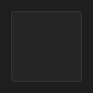

# Panel



Painel: um `Rectangle` com o estilo `Panel` do tema (fundo, borda e cantos).

**Paleta:** Standard · **controle visual** · também tem as [propriedades e eventos comuns a todo controle](controles.md)

## Propriedades

### Aparência

| Propriedade | No Object Inspector | Tipo | O que faz |
|---|---|---|---|
| `hover_fill` | Fundo com o mouse | cor | O fundo com o mouse em cima (nele ou num filho); vazio: como sem mouse. |
| `pressed_fill` | Fundo apertado | cor | O fundo apertado; vazio: o `hover_fill`. |
| `selected_fill` | Fundo marcado | cor | O fundo marcado (a linha escolhida de uma lista, o estado `checked`); vazio: com `interactive`, a cor principal do tema, clara. |
| `fill2` | Segunda cor do degradê | cor | Segunda cor: com ela, o fundo vira um gradiente de `fill` até `fill2`. |
| `fill_mid` | Cor do meio do degradê | cor | Cor do meio do gradiente (opcional), na posição `fill_mid_at`. |
| `fill_mid_at` | Posição da cor do meio | número | Onde fica a `fill_mid`, de 0 a 1 (0 = no meio). |
| `gradient_angle` | Ângulo do degradê | ângulo (graus) | Direção do gradiente em graus, como no CSS: 0 = para cima, 90 = para a direita. |
| `gradient_radial` | Degradê circular | lógico | Gradiente radial: `fill` no centro até `fill2` na borda (o menor raio do retângulo). |
| `stroke` | Cor do traço | cor | Cor da borda; vazio: a do tema. |
| `stroke_width` | Largura do traço | número | Espessura da borda, em pontos (0 = sem borda); vazio: a do tema. |
| `radius` | Raio dos cantos | número ou lista de números | Raio dos cantos: um número, ou `[cima-esquerda, cima-direita, baixo-direita, baixo-esquerda]`. Negativo curva o canto para fora (a aba que se funde no painel). Vazio: o do tema. |

### Comportamento

| Propriedade | No Object Inspector | Tipo | O que faz |
|---|---|---|---|
| `interactive` | Reage ao mouse | lógico | Reage ao mouse com as cores de estado do tema (o mesmo clarear dos botões), sem escolher cor: a linha de uma lista, um "botão" feito de painel (decidido em 21/11). O `hover_fill` e o `pressed_fill`, quando dados, mandam. |

### Teclado

| Propriedade | No Object Inspector | Tipo | O que faz |
|---|---|---|---|
| `allowed_chars` | Caracteres permitidos | texto | Os caracteres dos campos dentro do painel (veja o `Form`). |
| `blocked_chars` | Caracteres bloqueados | texto | Os caracteres que os campos de dentro não aceitam (digitados ou colados); vazio: nenhum. |
| `only_allowed` | Só os permitidos | lógico | Só os caracteres de `allowed_chars` entram nos campos de dentro. |
| `chars_override` | Força os caracteres | lógico | O filtro de caracteres do painel manda nos campos de dentro (sem ele, o do campo decide primeiro). |
| `char_map` | Trocas de caracteres | texto | Trocas do que o teclado produz nos campos de dentro (`",."`: vírgula por ponto), com a mesma herança dos filtros. |

### Posição e tamanho

| Propriedade | No Object Inspector | Tipo | O que faz |
|---|---|---|---|
| `gap` | Espaço entre itens | número | O vão entre os filhos encaixados (o `gap` do CSS; L05 do Tabernáculo). |

## Em código

No form, o `Panel1` com o evento ligado (no Object Inspector, na aba Eventos):

```json
{ "class": "Panel", "name": "Panel1" }
```

E o handler, um método do form (`self.Panel1` já é um `Panel`):

```rust
impl FrmPrincipal {
    pub fn form_show(&mut self, ui: &mut Ui, _sender: ComponentId, _args: &EventArgs) {
        let atual = self.Panel1.allowed_chars(ui);
        self.Panel1.set_allowed_chars(ui, format!("{atual}!"));
    }
}
```

(Sem eventos próprios: o exemplo usa o `on_show` do form.)

## Mais sobre o Panel

### A ordem do `align`

Os encaixados `top` e `bottom` ocupam a largura toda antes dos `left` e `right`,
qualquer que seja a ordem em que foram declarados: um `bottom` declarado depois de um `left`
ainda pega a largura inteira. Para uma barra lateral que vai até embaixo, ponha o rodapé dentro
do painel do conteúdo (o `client`), ou use `most_left`/`most_bottom`, que encaixam antes.

### Reagir ao mouse

Uma linha de lista ou um "botão" feito de painel clareia com o mouse em cima com `interactive`
(as cores de estado do tema) ou com `hover_fill` e `pressed_fill` (cores próprias). O mouse
num filho (o ícone, o texto) conta como em cima do painel. Foco pelo teclado e Enter continuam
sendo do `Button`.
