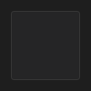

# Panel



Painel: um `Rectangle` com o estilo `Panel` do tema (fundo, borda e cantos).

**Paleta:** Standard · **controle visual** · também tem as [propriedades e eventos comuns a todo controle](controles.md)

## Propriedades

### Aparência

| Propriedade | No Object Inspector | Tipo |
|---|---|---|
| `fill2` | Segunda cor do degradê | cor |
| `fill_mid` | Cor do meio do degradê | cor |
| `fill_mid_at` | Posição da cor do meio | número |
| `gradient_angle` | Ângulo do degradê | ângulo (graus) |
| `gradient_radial` | Degradê circular | lógico |
| `stroke` | Cor do traço | cor |
| `stroke_width` | Largura do traço | número |
| `radius` | Raio dos cantos | número |

### Teclado

| Propriedade | No Object Inspector | Tipo |
|---|---|---|
| `allowed_chars` | Caracteres permitidos | texto |
| `blocked_chars` | Caracteres bloqueados | texto |
| `only_allowed` | Só os permitidos | lógico |
| `chars_override` | Força os caracteres | lógico |
| `char_map` | Trocas de caracteres | texto |

## Em código

No form, o `Panel1` com o evento ligado (no Object Inspector, na aba Eventos):

```json
{ "class": "Panel", "name": "Panel1" }
```

E o handler, um método do form (`self.Panel1` já é um `Panel`):

```rust
impl FrmPrincipal {
    pub fn form_show(&mut self, ui: &mut Ui, _sender: ComponentId, _args: &EventArgs) {
        let atual = self.Panel1.allowed_chars(ui);
        self.Panel1.set_allowed_chars(ui, format!("{atual}!"));
    }
}
```

(Sem eventos próprios: o exemplo usa o `on_show` do form.)
