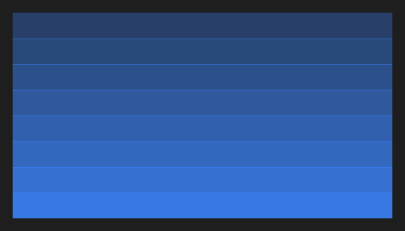

# Parallax



O fundo com paralaxe (`QParallax`): a imagem (`image`, um arquivo do app) anda mais devagar que a página quando a tela rola (`speed` de 0 a 1), atrás dos componentes colocados dentro dele (um título, um botão).

**Paleta:** Quasar · **controle visual** · também tem as [propriedades e eventos comuns a todo controle](controles.md)

## Propriedades

### Aparência

| Propriedade | No Object Inspector | Tipo |
|---|---|---|
| `image` | Imagem | texto |

### Comportamento

| Propriedade | No Object Inspector | Tipo |
|---|---|---|
| `speed` | Velocidade | número |

## Em código

No form, o `Parallax1` com o evento ligado (no Object Inspector, na aba Eventos):

```json
{ "class": "Parallax", "name": "Parallax1" }
```

E o handler, um método do form (`self.Parallax1` já é um `Parallax`):

```rust
impl FrmPrincipal {
    pub fn form_show(&mut self, ui: &mut Ui, _sender: ComponentId, _args: &EventArgs) {
        let atual = self.Parallax1.image(ui);
        self.Parallax1.set_image(ui, format!("{atual}!"));
    }
}
```

(Sem eventos próprios: o exemplo usa o `on_show` do form.)
