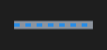

# Pipe



Cano preso a dois componentes (`from`/`to` e o lado de cada um): segue os dois e faz os cotovelos; `running` mostra o fluxo andando na cor do produto.

**Paleta:** Industrial · **controle visual** · também tem as [propriedades e eventos comuns a todo controle](controles.md)

## Propriedades

### Aparência

| Propriedade | No Object Inspector | Tipo |
|---|---|---|
| `flow_color` | Cor do fluxo | cor |
| `thickness` | Espessura | número |

### Comportamento

| Propriedade | No Object Inspector | Tipo |
|---|---|---|
| `from` | De | componente |
| `from_port` | Lado de saída | um de: `left`, `right`, `top`, `bottom` |
| `to` | Para | componente |
| `to_port` | Lado de chegada | um de: `left`, `right`, `top`, `bottom` |

### Dados

| Propriedade | No Object Inspector | Tipo |
|---|---|---|
| `running` | Ligado | lógico |
| `alarm` | Alarme | lógico |

## Em código

No form, o `Pipe1` com o evento ligado (no Object Inspector, na aba Eventos):

```json
{ "class": "Pipe", "name": "Pipe1" }
```

E o handler, um método do form (`self.Pipe1` já é um `Pipe`):

```rust
impl FrmPrincipal {
    pub fn form_show(&mut self, ui: &mut Ui, _sender: ComponentId, _args: &EventArgs) {
        let atual = self.Pipe1.running(ui);
        self.Pipe1.set_running(ui, !atual);
    }
}
```

(Sem eventos próprios: o exemplo usa o `on_show` do form.)
