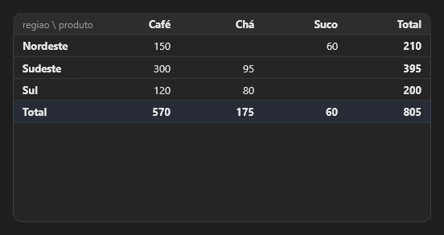

# PivotTable



Tabela dinâmica (pivot): agrupa os registros de `data` (texto com cabeçalho, campos separados por `;` e registros por linha) por `rows_field` nas linhas e `columns_field` nas colunas, juntando `values_field` com `aggregate`, com totais. Clique numa célula: `on_cell_click` com `"linha\tcoluna"` (o detalhamento, drill-down).

**Paleta:** BI · **controle visual** · também tem as [propriedades e eventos comuns a todo controle](controles.md)

## Propriedades

### Aparência

| Propriedade | No Object Inspector | Tipo |
|---|---|---|
| `decimals` | Casas decimais | inteiro |
| `totals` | Totais | lógico |

### Dados

| Propriedade | No Object Inspector | Tipo |
|---|---|---|
| `data` | Dados | texto |
| `rows_field` | Campo das linhas | texto |
| `columns_field` | Campo das colunas | texto |
| `values_field` | Campo dos valores | texto |
| `aggregate` | Agregação | um de: `sum`, `count`, `average`, `min`, `max` |

## Eventos

| Evento | Quando | No Object Inspector | Pergunta |
|---|---|---|---|
| `on_cell_click` | — | — |  |

## Em código

No form, o `PivotTable1` com o evento ligado (no Object Inspector, na aba Eventos):

```json
{ "class": "PivotTable", "name": "PivotTable1", "on_cell_click": "pivot_table1_cell_click" }
```

E o handler, um método do form (`self.PivotTable1` já é um `PivotTable`):

```rust
impl FrmPrincipal {
    pub fn pivot_table1_cell_click(&mut self, ui: &mut Ui, _sender: ComponentId, _args: &EventArgs) {
        let atual = self.PivotTable1.data(ui);
        self.PivotTable1.set_data(ui, format!("{atual}!"));
    }
}
```
