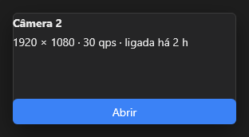

# Popover



Cartão flutuante: desenhado no form com os filhos, fica escondido até `popup(anchor)`, que o abre ao lado de `anchor`, por cima de tudo e sem sair do form. Fecha com o clique fora, o Escape ou `close()`, e avisa em `on_close`. A aparência é o estilo `Popover` do tema.

**Paleta:** Menus · **controle visual** · também tem as [propriedades e eventos comuns a todo controle](controles.md)

## Propriedades

### Aparência

| Propriedade | No Object Inspector | Tipo | O que faz |
|---|---|---|---|
| `fill2` | Segunda cor do degradê | cor | Segunda cor: com ela, o fundo vira um gradiente de `fill` até `fill2`. |
| `fill_mid` | Cor do meio do degradê | cor | Cor do meio do gradiente (opcional), na posição `fill_mid_at`. |
| `fill_mid_at` | Posição da cor do meio | número | Onde fica a `fill_mid`, de 0 a 1 (0 = no meio). |
| `gradient_angle` | Ângulo do degradê | ângulo (graus) | Direção do gradiente em graus, como no CSS: 0 = para cima, 90 = para a direita. |
| `gradient_radial` | Degradê circular | lógico | Gradiente radial: `fill` no centro até `fill2` na borda (o menor raio do retângulo). |
| `stroke` | Cor do traço | cor |  |
| `stroke_width` | Largura do traço | número |  |
| `radius` | Raio dos cantos | número ou lista de números | Raio dos cantos: um número, ou `[cima-esquerda, cima-direita, baixo-direita, baixo-esquerda]`. Negativo curva o canto para fora (a aba que se funde no painel). Vazio: o do tema. |

### Comportamento

| Propriedade | No Object Inspector | Tipo | O que faz |
|---|---|---|---|
| `placement` | Posição | um de: `bottom`, `top`, `right`, `left` |  |
| `gap` | Espaço entre itens | número | A distância até o componente. |

## Eventos

| Evento | Quando | No Object Inspector | Pergunta |
|---|---|---|---|
| `on_close` | o form fechou | — |  |

## Em código

No form, o `Popover1` com o evento ligado (no Object Inspector, na aba Eventos):

```json
{ "class": "Popover", "name": "Popover1", "on_close": "popover1_close" }
```

E o handler, um método do form (`self.Popover1` já é um `Popover`):

```rust
impl FrmPrincipal {
    pub fn popover1_close(&mut self, ui: &mut Ui, _sender: ComponentId, _args: &EventArgs) {
        let atual = self.Popover1.gap(ui);
        self.Popover1.set_gap(ui, atual + 10.0);
    }
}
```
