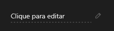

# PopupEdit



A edição no lugar (`QPopupEdit`): mostra o `text` (como um rótulo com um lápis) e, ao clicar (ou Enter), vira um campo; Enter (ou sair do campo) grava e dispara `on_save` com o texto novo; Esc desiste. Bom para tabelas e fichas editáveis.

**Paleta:** Quasar · **controle visual** · também tem as [propriedades e eventos comuns a todo controle](controles.md)

## Propriedades

### Aparência

| Propriedade | No Object Inspector | Tipo | O que faz |
|---|---|---|---|
| `placeholder` | Texto de exemplo | texto |  |

### Dados

| Propriedade | No Object Inspector | Tipo | O que faz |
|---|---|---|---|
| `text` | Texto | texto |  |

## Eventos

| Evento | Quando | No Object Inspector | Pergunta |
|---|---|---|---|
| `on_save` | — | — |  |

## Em código

No form, o `PopupEdit1` com o evento ligado (no Object Inspector, na aba Eventos):

```json
{ "class": "PopupEdit", "name": "PopupEdit1", "on_save": "popup_edit1_save" }
```

E o handler, um método do form (`self.PopupEdit1` já é um `PopupEdit`):

```rust
impl FrmPrincipal {
    pub fn popup_edit1_save(&mut self, ui: &mut Ui, _sender: ComponentId, _args: &EventArgs) {
        let atual = self.PopupEdit1.text(ui);
        self.PopupEdit1.set_text(ui, format!("{atual}!"));
    }
}
```
