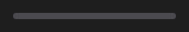

# ProgressBar



Barra de progresso. O trilho usa o `fill` do tema e a barra, o token `primary` (ou `color`, se definido).

**Paleta:** Standard · **controle visual** · também tem as [propriedades e eventos comuns a todo controle](controles.md)

## Propriedades

### Aparência

| Propriedade | No Object Inspector | Tipo |
|---|---|---|
| `color` | Cor | cor |

### Dados

| Propriedade | No Object Inspector | Tipo |
|---|---|---|
| `value` | Valor | número |
| `min` | Mínimo | número |
| `max` | Máximo | número |

## Em código

No form, o `ProgressBar1` com o evento ligado (no Object Inspector, na aba Eventos):

```json
{ "class": "ProgressBar", "name": "ProgressBar1" }
```

E o handler, um método do form (`self.ProgressBar1` já é um `ProgressBar`):

```rust
impl FrmPrincipal {
    pub fn form_show(&mut self, ui: &mut Ui, _sender: ComponentId, _args: &EventArgs) {
        let atual = self.ProgressBar1.value(ui);
        self.ProgressBar1.set_value(ui, atual + 10.0);
    }
}
```

(Sem eventos próprios: o exemplo usa o `on_show` do form.)
