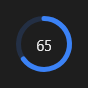

# ProgressCircle



Progresso redondo (o `v-progress-circular`): `value` de 0 a 100 com o número no meio (`show_value`), ou girando sem fim com `indeterminate`.

**Paleta:** Standard · **controle visual** · também tem as [propriedades e eventos comuns a todo controle](controles.md)

## Propriedades

### Aparência

| Propriedade | No Object Inspector | Tipo | O que faz |
|---|---|---|---|
| `indeterminate` | Sem progresso definido | lógico |  |
| `thickness` | Espessura | número |  |
| `show_value` | Mostra o valor | lógico |  |

### Dados

| Propriedade | No Object Inspector | Tipo | O que faz |
|---|---|---|---|
| `value` | Valor | número |  |

## Em código

No form, o `ProgressCircle1` com o evento ligado (no Object Inspector, na aba Eventos):

```json
{ "class": "ProgressCircle", "name": "ProgressCircle1" }
```

E o handler, um método do form (`self.ProgressCircle1` já é um `ProgressCircle`):

```rust
impl FrmPrincipal {
    pub fn form_show(&mut self, ui: &mut Ui, _sender: ComponentId, _args: &EventArgs) {
        let atual = self.ProgressCircle1.value(ui);
        self.ProgressCircle1.set_value(ui, atual + 10.0);
    }
}
```

(Sem eventos próprios: o exemplo usa o `on_show` do form.)
