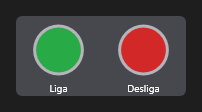

# PushButtons



Botoeira: botões de painel lado a lado (`buttons`: `{"text": "Liga", "color": "green"}, {"text": "Desliga", "color": "red"}`); o clique num deles dispara `on_click` com o texto dele (e o `item_index` fica com o índice).

**Paleta:** Industrial · **controle visual** · também tem as [propriedades e eventos comuns a todo controle](controles.md)

## Propriedades

### Dados

| Propriedade | No Object Inspector | Tipo | O que faz |
|---|---|---|---|
| `buttons` | Botões | lista de `PushButton` | Os botões, em JSON (`PUSH_BUTTON`): o texto e a cor de cada um (pelo nome de painel `green`, `red`, `yellow`, `blue`, `black`, por `#rrggbb` ou do tema; sem cor: cinza). |
| `item_index` | Item escolhido | inteiro | O botão que está aceso (o último clicado; -1 = nenhum). |

## Em código

No form, o `PushButtons1` com o evento ligado (no Object Inspector, na aba Eventos):

```json
{ "class": "PushButtons", "name": "PushButtons1" }
```

E o handler, um método do form (`self.PushButtons1` já é um `PushButtons`):

```rust
impl FrmPrincipal {
    pub fn form_show(&mut self, ui: &mut Ui, _sender: ComponentId, _args: &EventArgs) {
        let atual = self.PushButtons1.item_index(ui);
        self.PushButtons1.set_item_index(ui, atual + 1);
    }
}
```

(Sem eventos próprios: o exemplo usa o `on_show` do form.)
