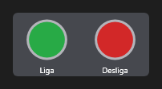

# PushButtons



Botoeira: botões de painel lado a lado (`buttons`: `Liga:green;Desliga:red`); o clique num deles dispara `on_click` com o índice (e o texto) dele.

**Paleta:** Industrial · **controle visual** · também tem as [propriedades e eventos comuns a todo controle](controles.md)

## Propriedades

### Dados

| Propriedade | No Object Inspector | Tipo |
|---|---|---|
| `buttons` | Botões | texto |
| `item_index` | Item escolhido | inteiro |

## Em código

No form, o `PushButtons1` com o evento ligado (no Object Inspector, na aba Eventos):

```json
{ "class": "PushButtons", "name": "PushButtons1" }
```

E o handler, um método do form (`self.PushButtons1` já é um `PushButtons`):

```rust
impl FrmPrincipal {
    pub fn form_show(&mut self, ui: &mut Ui, _sender: ComponentId, _args: &EventArgs) {
        let atual = self.PushButtons1.buttons(ui);
        self.PushButtons1.set_buttons(ui, format!("{atual}!"));
    }
}
```

(Sem eventos próprios: o exemplo usa o `on_show` do form.)
