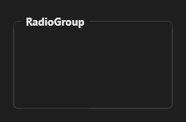

# RadioGroup



Grupo de opções exclusivas com título e moldura. `items` separados por `;`, `item_index` escolhido, `columns` colunas. `on_change` traz o texto.

**Paleta:** Standard · **controle visual** · também tem as [propriedades e eventos comuns a todo controle](controles.md)

## Propriedades

### Aparência

| Propriedade | No Object Inspector | Tipo |
|---|---|---|
| `caption` | Título | texto |
| `columns` | Colunas | inteiro |

### Dados

| Propriedade | No Object Inspector | Tipo |
|---|---|---|
| `items` | Itens | texto |
| `item_index` | Item escolhido | inteiro |

## Eventos

| Evento | Quando | No Object Inspector | Pergunta |
|---|---|---|---|
| `on_change` | o valor mudou (pelo usuário ou pelo código, como na VCL) | — |  |

## Em código

No form, o `RadioGroup1` com o evento ligado (no Object Inspector, na aba Eventos):

```json
{ "class": "RadioGroup", "name": "RadioGroup1", "on_change": "radio_group1_change" }
```

E o handler, um método do form (`self.RadioGroup1` já é um `RadioGroup`):

```rust
impl FrmPrincipal {
    pub fn radio_group1_change(&mut self, ui: &mut Ui, _sender: ComponentId, _args: &EventArgs) {
        let atual = self.RadioGroup1.caption(ui);
        self.RadioGroup1.set_caption(ui, format!("{atual}!"));
    }
}
```
