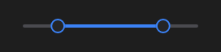

# RangeSlider



Controle deslizante de intervalo (o `v-range-slider`): `low` e `high` entre `min` e `max`, com passo `step` (0 = contínuo). Arrasta o controle mais perto.

**Paleta:** Standard · **controle visual** · também tem as [propriedades e eventos comuns a todo controle](controles.md)

## Propriedades

### Dados

| Propriedade | No Object Inspector | Tipo | O que faz |
|---|---|---|---|
| `low` | Limite baixo | número | O começo do intervalo escolhido (o controle da esquerda). |
| `high` | Limite alto | número | O fim do intervalo escolhido (o controle da direita). |
| `min` | Mínimo | número | O menor valor do trilho. |
| `max` | Máximo | número | O maior valor do trilho. |
| `step` | Passo | número | O passo dos valores; 0 = contínuo. |

## Eventos

| Evento | Quando | No Object Inspector | Pergunta |
|---|---|---|---|
| `on_change` | o valor mudou (pelo usuário ou pelo código) | — |  |

## Em código

No form, o `RangeSlider1` com o evento ligado (no Object Inspector, na aba Eventos):

```json
{ "class": "RangeSlider", "name": "RangeSlider1", "on_change": "range_slider1_change" }
```

E o handler, um método do form (`self.RangeSlider1` já é um `RangeSlider`):

```rust
impl FrmPrincipal {
    pub fn range_slider1_change(&mut self, ui: &mut Ui, _sender: ComponentId, _args: &EventArgs) {
        let atual = self.RangeSlider1.low(ui);
        self.RangeSlider1.set_low(ui, atual + 10.0);
    }
}
```
