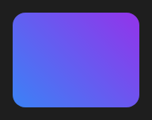

# Rectangle



Retângulo. Cada propriedade vazia (`Null`) usa o valor do tema.

**Paleta:** Shapes · **controle visual** · também tem as [propriedades e eventos comuns a todo controle](controles.md)

## Propriedades

### Aparência

| Propriedade | No Object Inspector | Tipo | O que faz |
|---|---|---|---|
| `fill2` | Segunda cor do degradê | cor | Segunda cor: com ela, o fundo vira um gradiente de `fill` até `fill2`. |
| `fill_mid` | Cor do meio do degradê | cor | Cor do meio do gradiente (opcional), na posição `fill_mid_at`. |
| `fill_mid_at` | Posição da cor do meio | número | Onde fica a `fill_mid`, de 0 a 1 (0 = no meio). |
| `gradient_angle` | Ângulo do degradê | ângulo (graus) | Direção do gradiente em graus, como no CSS: 0 = para cima, 90 = para a direita. |
| `gradient_radial` | Degradê circular | lógico | Gradiente radial: `fill` no centro até `fill2` na borda (o menor raio do retângulo). |
| `stroke` | Cor do traço | cor | Cor da borda; vazio: a do tema. |
| `stroke_width` | Largura do traço | número | Espessura da borda, em pontos (0 = sem borda); vazio: a do tema. |
| `radius` | Raio dos cantos | número ou lista de números | Raio dos cantos: um número, ou `[cima-esquerda, cima-direita, baixo-direita, baixo-esquerda]`. Negativo curva o canto para fora (a aba que se funde no painel). Vazio: o do tema. |

## Em código

No form, o `Rectangle1` com o evento ligado (no Object Inspector, na aba Eventos):

```json
{ "class": "Rectangle", "name": "Rectangle1" }
```

E o handler, um método do form (`self.Rectangle1` já é um `Rectangle`):

```rust
impl FrmPrincipal {
    pub fn form_show(&mut self, ui: &mut Ui, _sender: ComponentId, _args: &EventArgs) {
        let atual = self.Rectangle1.fill_mid_at(ui);
        self.Rectangle1.set_fill_mid_at(ui, atual + 10.0);
    }
}
```

(Sem eventos próprios: o exemplo usa o `on_show` do form.)
