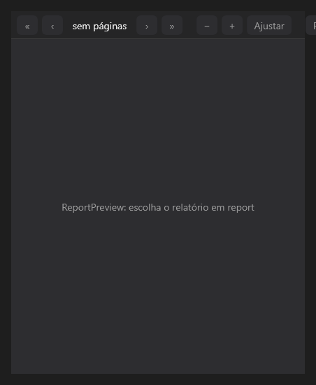

# ReportPreview



A visualização de um `Report` (como o preview do FastReport): uma página por vez, com a barra para navegar (`page`), aproximar (`zoom`; 0 = a página inteira na largura), exportar para PDF e imprimir. Atualiza sozinha quando os dados mudam; por código, `ReportPreview::refresh`.

**Paleta:** Reports · **controle visual** · também tem as [propriedades e eventos comuns a todo controle](controles.md)

## Propriedades

### Aparência

| Propriedade | No Object Inspector | Tipo | O que faz |
|---|---|---|---|
| `toolbar` | Barra de ferramentas | lógico | Mostra a barra de botões. |

### Comportamento

| Propriedade | No Object Inspector | Tipo | O que faz |
|---|---|---|---|
| `page` | Página | inteiro | A página mostrada, a partir de 0. |
| `zoom` | Zoom | número | A escala da página (1 = tamanho real); 0: a página inteira na largura. |

### Dados

| Propriedade | No Object Inspector | Tipo | O que faz |
|---|---|---|---|
| `report` | Relatório | componente | O `Report` mostrado. |

## Eventos

| Evento | Quando | No Object Inspector | Pergunta |
|---|---|---|---|
| `on_export` | — | — |  |
| `on_print` | — | — |  |

## Em código

No form, o `ReportPreview1` com o evento ligado (no Object Inspector, na aba Eventos):

```json
{ "class": "ReportPreview", "name": "ReportPreview1", "on_export": "report_preview1_export" }
```

E o handler, um método do form (`self.ReportPreview1` já é um `ReportPreview`):

```rust
impl FrmPrincipal {
    pub fn report_preview1_export(&mut self, ui: &mut Ui, _sender: ComponentId, _args: &EventArgs) {
        let atual = self.ReportPreview1.page(ui);
        self.ReportPreview1.set_page(ui, atual + 1);
    }
}
```
